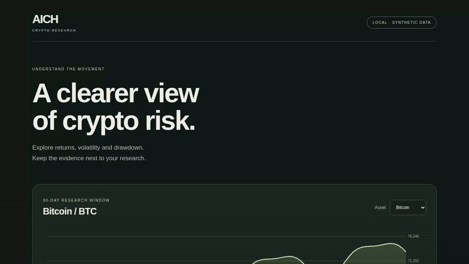

# AICH — cryptocurrency research workspace

A usable local first slice of the original AI-powered Cryptocurrency Hub concept: a research dashboard, transparent risk metrics, methodology notes and a persistent research forum.

## Run

Python 3.10+; no third-party dependencies, API keys or network required.

```sh
python app.py
# Open http://127.0.0.1:8080
python -m unittest discover -s tests -v
```

Choose BTC, ETH or SOL to explore a 90-day price chart, total return, annualized sample volatility and maximum drawdown. Add or delete a research note; both changes survive server restarts in `workspace.sqlite3`. Set `--db /path/to/file.sqlite3` for another workspace or `--port 9000` for another port.

## What the demo actually does



[Download the MP4 demo](docs/demo/aich-workspace.mp4) · [Recording receipt](docs/demo/capture.json)

The recorded workflow switches between synthetic fixture assets, opens the metric methodology, saves a local SQLite note, reloads to prove persistence, deletes it, and reloads again to prove removal. The recording is pinned to the exact application source in its receipt and is checked for source drift and complete GIF/MP4 decoding in CI.

The dashboard reads the same HTTP API a client can use:

```sh
curl 'http://127.0.0.1:8080/api/analysis?symbol=BTC'
curl http://127.0.0.1:8080/api/news
curl -H 'Content-Type: application/json' -d '{"author":"Researcher","body":"Compare volatility with drawdown."}' http://127.0.0.1:8080/api/posts
curl http://127.0.0.1:8080/api/posts
curl -X DELETE http://127.0.0.1:8080/api/posts/1
```

The API validates text limits and post identifiers, persists note additions/deletions with parameterized SQLite statements, returns JSON errors, blocks cross-origin browser writes and serves only allowlisted static files. User text is rendered as text, never HTML.

**All prices and methodology notes are explicitly synthetic fixtures, dated January 1, 2025.** Risk metrics are calculated from those fixtures. There is no live market feed, LLM prediction model, scraped news, wallet or trading path. This is a local research tool, not an authenticated multi-user service. It binds to loopback only; do not expose it publicly without authentication, limits, CSRF protection and a production HTTP server.

## Remaining product work

Before calling this an AI or live-market product, select a licensed market/news provider and verify timestamps, missing prices and rate-limit behavior. Any model needs a defined prediction target, chronological evaluation, leakage checks and fee-aware backtests. Multi-user hosting needs identity, scoped data access and deployment tests. The original README's NestJS/Next.js tree was a plan rather than existing code; this slice deliberately establishes runnable behavior before introducing those dependencies.

## Recording walkthrough

Start with a clean `--db /tmp/aich-demo.sqlite3`, open the dashboard, switch assets, expand the methodology, save a note, reload to show persistence, then delete and reload to prove removal. Keep the synthetic-data badge visible. Record only after the tests and browser workflow pass at the exact recorded commit.
